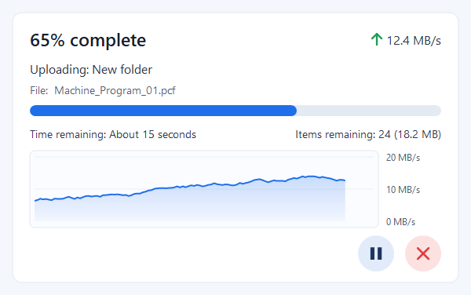

# Mitsubishi Uploader

A small Windows tool that sends files and folders to a Mitsubishi CNC memory card through **NC Explorer**.
Right-click a file or folder, choose **Mitsubishi Uploader**, and it is copied to the CNC, keeping its subfolders.



## Features

- **Right-click upload** for files and folders (folders are uploaded with all subfolders)
- **One window, one queue**: files sent while an upload is running are added to the same window
- Live **progress, speed, time remaining, items remaining** and a speed graph
- **Pause / resume** and **cancel**
- Timeouts, so a CNC that stops answering never freezes the window
- Each failed file is **retried once**; the rest of the batch continues, and a summary shows what failed
- **One login per batch**, so large folders upload quickly
- **Settings file** for the CNC IP address and destination folder, so no rebuild is needed

## Install

Download from the [latest release](https://github.com/harshaloza/MitsubishiUploader/releases/latest):

| File | Use |
|---|---|
| `MitsubishiUploader-Setup.exe` | **Recommended.** Double-click and answer *Yes*. Installs to `C:\Mitsubishi Uploader` and adds the right-click menu, a Start menu shortcut and an entry in *Settings > Apps*. No admin rights needed. |
| `MitsubishiUploader.exe` | Portable copy with no install and no right-click menu. Drag files onto its window to upload. |

Running a newer setup updates the installed copy, including copies installed by older versions of `Install-MitsubishiUploader.bat`.
If the uploader is open, setup closes it first.

**Uninstall:** go to *Windows Settings > Apps > Installed apps > Mitsubishi Uploader > Uninstall*.
This removes the program, the right-click menu and the shortcut. Your settings file is kept, so a later reinstall uses the same IP address and folder.

For scripts: `MitsubishiUploader.exe --install` or `--uninstall`, plus `--quiet` to skip the questions.

Windows SmartScreen may warn the first time, because the setup is not code-signed. Click *More info > Run anyway*.

## Settings: CNC IP address and destination folder

Click the **gear button** in the window, or open `C:\Mitsubishi Uploader\MitsubishiUploader.settings.json` in Notepad.
The file is created automatically the first time the uploader runs.

```jsonc
{
  // IP address of the CNC, as shown in NC Explorer.
  "CncIpAddress": "192.168.200.1",

  // Folder on the CNC to copy files into.
  // Use / for a subfolder, for example "MEMORY CARD/PROGRAMS". The folder must already exist.
  "DestinationFolder": "MEMORY CARD",

  // NC Explorer connection. Normally there is no need to change these.
  "NcExplorerHost": "NCExplorer",
  "NcExplorerPort": 1217,
  "UserName": "MITSUBISHI",
  "Password": "CNC"
}
```

- Save the file and the next upload uses the new values. No restart is needed.
- The window shows where files will go, for example *Sending to: 192.168.200.1 > MEMORY CARD*.
- If the file has a mistake, the window says what is wrong and on which line.
- To go back to the defaults, delete the file. It is created again.

## Requirements

- Windows 10 or 11 (64-bit)
- Mitsubishi **NC Explorer** running on the PC and connected to the CNC
- No .NET install needed: the exe is self-contained

## Build from source

Requires the [.NET 8 SDK](https://dotnet.microsoft.com/download/dotnet/8.0).

| Script | What it does |
|---|---|
| `Build-Release.bat` | Builds `dist\MitsubishiUploader-Setup.exe` and `dist\MitsubishiUploader.exe` |
| `Build-SingleEXE.bat` | Builds `bin\Release\net8.0-windows\win-x64\publish\MitsubishiUploader.exe` only |
| `Install-MitsubishiUploader.bat` | Installs the exe built by `Build-SingleEXE.bat` |
| `Uninstall-MitsubishiUploader.bat` | Uninstalls, the same as *Settings > Apps > Uninstall* |

Setup and the program are the same exe: named `...Setup.exe`, or started with `--install`, it installs itself.

### Tests

`tests/` contains a test program that runs the uploader against a built-in fake FTP server. It covers folders, retry, timeouts, cancel, pause, the queue, the single-window hand-off and the settings file.

```bash
dotnet run --project tests/MitsubishiUploader.Tests.csproj -c Release
```

## Code layout

| File | What it does |
|---|---|
| `Program.cs` | Entry point. Keeps a single window: a second launch sends its files to the open window over a named pipe. |
| `MainForm.cs` | The window: queue, progress, speed, pause/cancel, settings button |
| `UploaderView.cs` | Draws the window content |
| `UploadEngine.cs` | Upload queue, retry, pause, progress counters |
| `FtpSession.cs` | FTP over NC Explorer: login, folders, timeouts, file transfer |
| `AppSettings.cs` | Reads and checks the settings file |
| `Installer.cs` | Setup and uninstall: copies the exe and adds or removes the right-click menu, Start menu shortcut and *Settings > Apps* entry |

## License

[MIT](LICENSE). Mitsubishi and NC Explorer are trademarks of Mitsubishi Electric. This project is not affiliated with or endorsed by Mitsubishi Electric.
